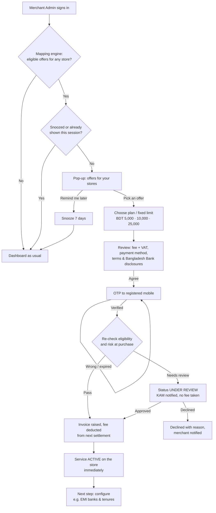

# Self-Service Activation — Process Flow

Existing merchants can buy and switch on add-on services (Digital EMI with a fixed
limit, Instant Settlement…) from the portal. Today the KAM / Operations team checks
the merchant's work order by hand before enabling a feature. Digital mapping replaces
that check: the system already knows each store's profile, so it decides what the
store may buy and shows it as a pop-up offer.

## Actors

| Actor | Role in the flow |
| --- | --- |
| Merchant Admin | Sees the offer, picks a plan, consents, confirms with OTP |
| Other merchant users | See the offer as read-only; asked to contact their admin |
| Mapping engine | Matches each store to services and plans it is eligible for |
| Risk / compliance check | Re-runs eligibility at purchase time; may send to manual review |
| Billing | Raises the invoice (fee + 15% VAT), deducts from the next settlement |
| KAM / Operations | Only handles stores sent to manual review — no work-order check otherwise |

## Flow

The same flow also starts from **Others → Services & Add-ons** and from a banner on
any page whose feature is off (e.g. Digital EMI for a store without EMI), so the
pop-up is a reminder, not the only door.

## Steps

| # | Step | What the merchant sees | System / rules |
| --- | --- | --- | --- |
| 1 | Digital mapping | — | Per store: Active, BDT currency, KYC complete, no compliance hold. Each service adds its own rules (EMI: not already on). Ineligible stores keep a reason. |
| 2 | Pop-up offer | Up to 3 offers, each naming the store and why it qualifies | Shown once per session to Merchant Admins; "Remind me later" snoozes 7 days; never covers sign-in or an open form |
| 3 | Choose plan | Fixed-limit cards (5k / 10k / 25k), fee per plan, one marked Recommended | Plans and fees come from the catalog, not typed by the merchant |
| 4 | Review & consent | Fee, 15% VAT, total, payment method, terms, disclosures | Default payment is deduction from next settlement — no card entry in the portal (keeps PCI scope out) |
| 5 | OTP confirm | 6-digit code to the masked registered mobile | Step-up auth for a purchase; 3 tries, 5-minute expiry |
| 6 | Activate | Success screen + reference number; next-step button | Eligibility re-checked server-side; audit log: user, time, IP, plan, terms version |
| 7 | Track | Services & Add-ons page lists active plans, references, status | Invoice in Settlement Report; KAM sees the activation in their panel |

## States

`Eligible → Offered → Plan selected → Consented → Verified → Active`
with side exits `Snoozed`, `Under review`, `Declined`, `Cancelled`.

## Compliance notes

- **Bangladesh Bank:** EMI only on credit cards from participating issuer banks; the
  customer-facing EMI charge must be disclosed before payment. Fixed limits keep a
  newly self-activated store's EMI exposure small until it builds history.
- **Maker-checker:** low-limit plans auto-activate; higher limits (or any risk flag)
  go to KAM review instead of auto-approval.
- **Audit trail:** every consent stores user, timestamp, IP, terms version and OTP
  result. Retain per Bangladesh Bank record-keeping rules.
- **Privacy:** the pop-up shows store names and plan prices only — no transaction
  amounts, customer data or bank account numbers. Mobile numbers stay masked.
- **Role check:** only Merchant Admin can buy; other roles see the offer read-only.

## Prototype scope

The portal prototype implements steps 2–7 with mock data: no OTP is sent, no fee is
charged and nothing reaches the server. Mapping rules are computed from the mock
store list in `js/data.js`.
